# yucode

A coding-agent harness for a locked-down corporate Windows machine, being
rewritten from Python to TypeScript. The Python implementation is preserved at
`python-final`; its measured outputs live in `tests/golden/`.

Implementation is being held at the WP0 scaffold while the owner reviews the
methodology and waits before continuing the agent port. This README is a
handoff map of the executable code, the intended architecture, and the design
questions that remain. No TypeScript agent can run a chat or execute tools yet.

## Reading this map

| Mark      | Meaning                                                                            |
| --------- | ---------------------------------------------------------------------------------- |
| `CURRENT` | Exists in this checkout; follow the linked source                                  |
| `LEGACY`  | Python behaviour in `python-final` / the untracked `_legacy_python/` backup        |
| `PLANNED` | TypeScript design in the rewrite plan; no corresponding runtime implementation yet |
| `OPEN`    | A decision or verification gate remains; the diagram does not settle it            |

Arrows show control flow or data dependencies, as labelled. Diagrams labelled
PLANNED describe intended responsibilities, not implemented guarantees. They
use Mermaid so GitHub can render them and future edits remain reviewable text.

| Question                                               | Source of truth                                                                                      |
| ------------------------------------------------------ | ---------------------------------------------------------------------------------------------------- |
| What exists and runs now?                              | [Source](src/), [tests](tests/), [package scripts](package.json) and the CURRENT diagrams below      |
| What should be built, and in what order?               | [Rewrite plan](docs/REWRITE_PLAN.md), with §0.0 corrections taking precedence over its body          |
| What are the intended boundaries and frozen contracts? | [Architecture](docs/ARCHITECTURE.md)                                                                 |
| What did Python actually do?                           | [Implementation summary](docs/PYTHON_IMPLEMENTATION_SUMMARY.md), then the cited tagged source        |
| What output must a port reproduce?                     | [Harness goldens](tests/golden/harness/) and [Office goldens](tests/golden/office/)                  |
| Why did a decision happen?                             | [Journal](docs/journal/README.md), including the [current review](docs/journal/2026-10-26_review.md) |
| How can a comparable live baseline be captured?        | [Single-loop eval procedure](docs/EVAL_BASELINE.md)                                                  |

The tables and diagrams here are an index. They do not replace the plan,
change a contract, or override a measured golden.

Jump to the [current executable](#1-current-everything-the-typescript-application-does),
[verification paths](#2-current-build-supply-chain-and-verification-paths),
[planned architecture](#3-planned-full-agent-architecture),
[turn loop](#4-planned-one-user-turn-and-its-stopping-conditions),
[methodology and open issues](#11-methodology-what-the-evidence-can-establish),
or [resume gates](#12-resume-map-and-work-package-gates).

## 1. CURRENT: everything the TypeScript application does

There are two source files under `src/`. The CLI returns the version for
`version`, `--version` and `-v`; every other invocation prints the scaffold
notice and exits 0. In particular, `chat` is not a supported command yet and
its current exit code must not be interpreted as task success.

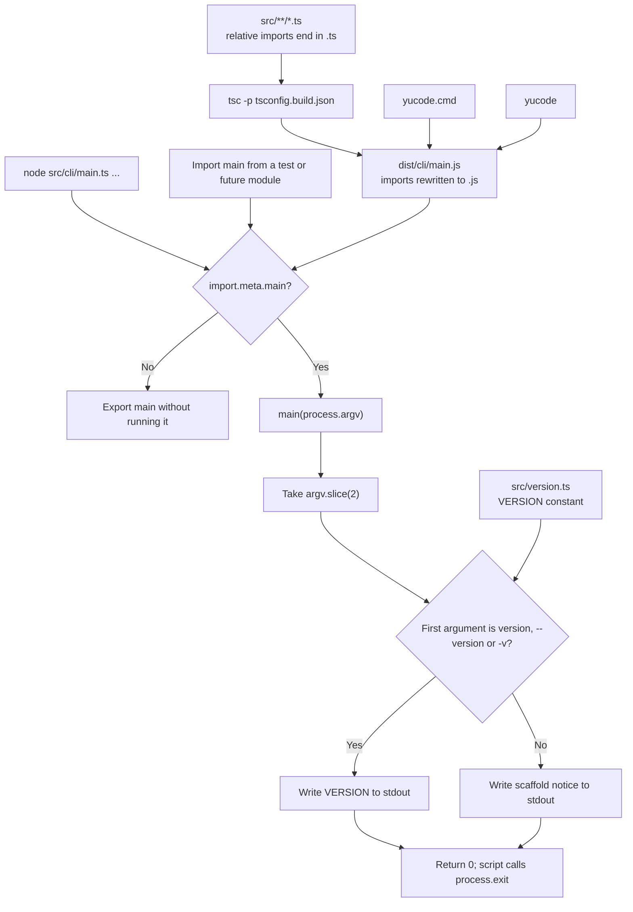

Sources: [CLI](src/cli/main.ts), [version](src/version.ts),
[build config](tsconfig.build.json), [Windows launcher](yucode.cmd),
[POSIX launcher](yucode). The version-to-package and subprocess entry-point
checks are in [smoke tests](tests/smoke.test.ts).

| Area                                                         | Status in this checkout                                            |
| ------------------------------------------------------------ | ------------------------------------------------------------------ |
| TypeScript toolchain, launchers, lint boundaries             | CURRENT                                                            |
| Native-dependency scanner and its regression tests           | CURRENT; see the review journal for scope                           |
| Python capture recipes, synthetic inputs and frozen outputs  | CURRENT verification tooling; requires legacy Python for recapture |
| Resolved TypeScript config and trust gate                    | PLANNED, WP1                                                       |
| Provider, event log, registry, runtime, CLI chat             | PLANNED, M1                                                        |
| Sub-agent tool, interactive TUI                              | PLANNED, M2                                                        |
| Native Office/PDF tools and office MCP server                | PLANNED, M3                                                        |
| Diagnostics, bridge, HTTP server, plugins, deployment bundle | PLANNED, M4/M5                                                     |

No runtime dependency is currently declared in `package.json`. References to
Zod, YAML, Ink, the MCP SDK and Office libraries below describe future work.

## 2. CURRENT: build, supply-chain and verification paths

The build has separate typecheck and emit configurations. Node executes
source tests through type stripping; the launchers execute the compiled tree.
The rule against native dependencies applies to development dependencies too.

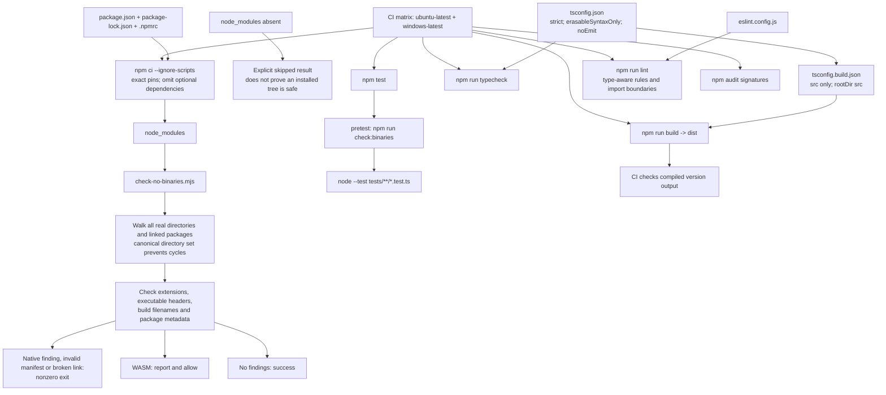

Sources: [scanner](scripts/check-no-binaries.mjs),
[scanner tests](tests/check-no-binaries.test.ts), [lint config](eslint.config.js),
[CI](.github/workflows/ci.yml). The scanner checks unpacked files; compressed
archives are outside its inspection. Header detection is conservative, not a
complete executable parser. Passing it does not prove the target EDR accepts
WASM. Release automation is [disarmed](.github/workflows/release.yml) until WP24.

### CURRENT: where the oracle comes from

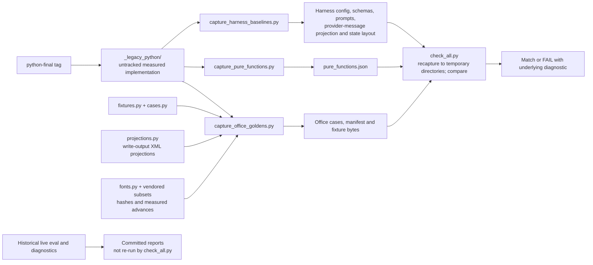

There are 17 harness files and 103 Office cases in the current oracle. Those
counts describe captured material, not TypeScript parity coverage. The
aggregate check invokes the three maintained capture scripts. Environment
metadata has explicitly nonblocking differences; inspect each check's rules
before treating it as a byte-for-byte comparison of every field.

The TypeScript smoke tests check JSON parsing, case-ID consistency, fixture
presence and selected path leaks. They do not recapture the Python outputs,
assert all fixture contents, or establish that a future agent answers well.

## 3. PLANNED: full agent architecture

The central boundary is between the stateful runtime and the testable turn
loop. The loop takes injected dependencies and emits events. Consumers render
or transport those events; the core does not import their implementation.

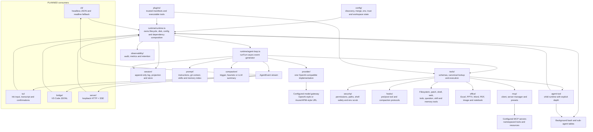

The ESLint boundary already forbids imports from `cli`, `tui`, `bridge`,
`server` and `plugins` inside `runtime`, `tools`, `provider` and `session`.
It will constrain those modules once they exist. Runtime composition must use
injected interfaces for plugin contributions rather than importing the plugin
host back into the core. The diagram's arrows are runtime/data relationships;
they do not grant permission to create a forbidden static import.

### PLANNED contracts that connect the boxes

| Contract                        | Inputs                                                                    | Output / responsibility                                      | Evidence and work package |
| ------------------------------- | ------------------------------------------------------------------------- | ------------------------------------------------------------ | ------------------------- |
| `ToolDef`                       | Name, contract description, schema, permission, risk, optional preview    | Execute with a `ToolContext`; expose provider JSON Schema    | Plan §3.4; WP4            |
| `ToolContext`                   | Workspace, config, state dir, cancellation and task tables                | Canonical path resolution, bounded spill, events, MCP access | Plan §3.4; WP4/WP9        |
| `Provider.complete`             | Projected messages, tool schemas, signal, body overrides, event callback  | Text, tool calls, usage, reasoning and finish reason         | Plan §3.4; WP2            |
| `SessionLog` + `deriveMessages` | Append-only session events and projection options                         | Durable history separate from model-facing messages          | Plan §3.4; WP3            |
| `runTurn`                       | Prompt, log, provider, registry, policy, hooks, options, signal and depth | `AgentEvent` stream and a turn summary                       | Plan §3.4; WP9            |
| Consumer adapter                | User input and runtime events                                             | Presentation, JSONL or HTTP/SSE transport                    | WP10/WP14/WP21/WP22       |

These signatures are planned contracts, not exported TypeScript interfaces in
this checkout. Session events persist history; `AgentEvent` is the consumer
stream. Their vocabularies overlap but should not be assumed identical.

## 4. PLANNED: one user turn and its stopping conditions

This expands the plan's §3.5. The exact legacy stage ordering and the
corrections matter more than whether the eventual code resembles the Python.

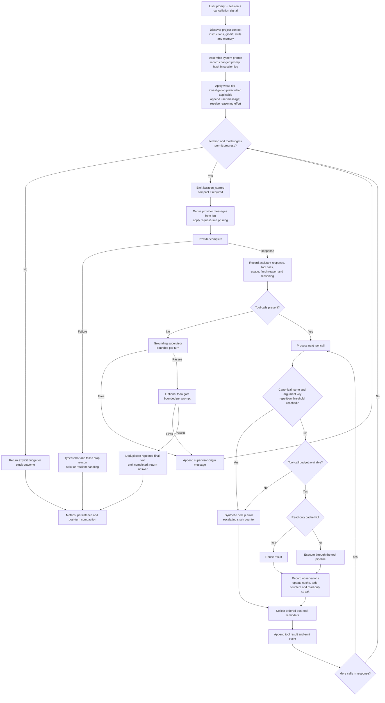

| Mechanism            | Preserved behaviour / design limit                                                                                                                               |
| -------------------- | ---------------------------------------------------------------------------------------------------------------------------------------------------------------- |
| Dedup key            | Tool name plus hash of canonically sorted argument JSON; whitespace and key order do not create new work                                                         |
| Dedup escalation     | Repeated identical requests produce synthetic errors; three blocked calls trigger the legacy stuck outcome                                                       |
| Tool budget          | Distinct from iteration budget and provider retries; blocked calls do not execute the handler                                                                    |
| Read-only cache      | Within-turn reuse; LEGACY returns stale content after a write in the measured case below; port invalidation policy remains OPEN                                  |
| Read-only advisory   | At eight consecutive read-only calls; cache hits count, dedup/budget blocks do not advance observations or streak                                                |
| Grounding supervisor | Checks grep-without-read on weak-tier investigations, success claims after failed bash, and time-sensitive answers without web search; at most one fire per turn |
| Todo gate            | Optional; separately capped; must not become an unbounded retry loop                                                                                             |
| Reminder order       | Finished background bash, finished sub-agents, todo nudge, new instruction discovery, new skill discovery                                                        |
| Cancellation         | Explicit signal must reach provider, tools and child runtimes; preserve already streamed text; implementation tests remain pending                               |

Sources: summary §5 and plan §3.5. A `completed` event does not by itself
prove the requested task succeeded: budget exhaustion and other non-success
paths need an explicit stop reason in the consumer's result.

## 5. PLANNED: a tool call crosses several independent gates

A model proposes a call. The host controls authorization and effects. Schema
validation alone does not establish that the path, command or action is
permitted.

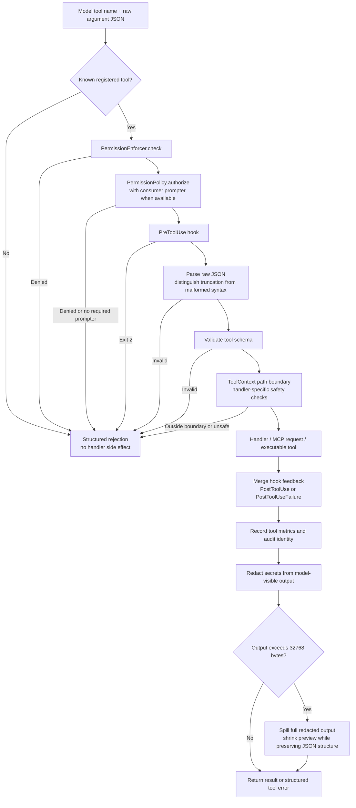

This order follows the documented Python pipeline plus planned schema
validation. Post hooks, audit and early-denial accounting have branch-specific
behaviour; the simplified graph does not imply every rejected call traverses
the handler-success tail. Hooks receive raw arguments before JSON parsing in
the legacy pipeline. Reordering that boundary needs its own decision and test.

| Boundary              | What must be enforced or preserved                                                                                            |
| --------------------- | ----------------------------------------------------------------------------------------------------------------------------- |
| Path handling         | Normalize model-typed backslashes; resolve canonically; require workspace containment                                         |
| Spill reads           | Narrow read-only exception for `tool_output` and `bash_output`; no general access to audit, sessions, archives or checkpoints |
| MCP server path guard | Rewrite path-like arguments to resolved absolute paths before handlers run                                                    |
| Shell                 | Permission and safety checks; fresh shell per call; timeout and explicit cwd; output tee/spill                                |
| Child environment     | Shared scrubber for bash, hooks, plugin tools and stdio MCP; preserve required proxy/CA settings                              |
| Hooks                 | Five legacy events; JSON stdin; allow/feedback on 0, deny on 2, warn on other failures; 30-second timeout                     |
| Error transport       | Preserve `error`, `error_code`, `recoverable` and optional `suggestion` semantics                                             |
| Output storage        | Verify which sinks receive raw vs redacted content; a redacted model preview alone does not establish audit confidentiality   |

LEGACY permission order starts with an `allow`-mode short circuit, which
ignores deny rules. In other modes it proceeds through deny, override, ask,
whole-command allow, prompt and permission-level comparison. Correction 28
warns that implementing deny-first in every mode changes the security model.
The README does not silently select either policy for the port.

## 6. PLANNED: provider transport and recovery

WP2 ports one provider implementation. It owns protocol compatibility and
recovery; it does not decide whether a user's task is complete.

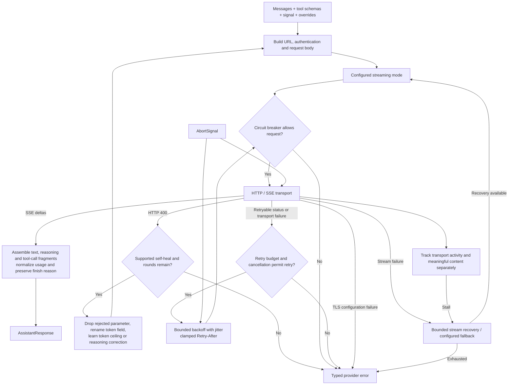

| LEGACY mechanism to port | Boundary that matters                                                                                               |
| ------------------------ | ------------------------------------------------------------------------------------------------------------------- |
| Request shaping          | OpenAI-compatible path or deployment/API-version path; `api-key` vs bearer authentication; omit/extra-body rules    |
| HTTP retries             | `_MAX_RETRIES = 5`, exponential backoff and jitter; retryability is broader than breaker membership                 |
| Circuit breaker          | Only origin-down 521–524 count as breaker failures; threshold 3, cooldown 30 seconds                                |
| Rate and proxy errors    | 429/529 and 500/502/503/504/520 must not all be reclassified as shared origin failure                               |
| Self-heal                | At most four rounds; learned parameter fixes remain scoped to the provider instance                                 |
| Stream retries           | `_MAX_STREAM_RETRIES = 2`; partial-response handling must be tested before replaying work                           |
| Stall detection          | Transport inactivity 120 seconds; content inactivity 300 seconds; heartbeats cannot keep content alive indefinitely |
| Fallback parsing         | Structured tool calls first; legacy text-tag/control-character repair is compatibility behaviour requiring fixtures |
| Usage                    | Normalize supported vocabularies and cache buckets without double-counting                                          |

Sources: summary §9 and the tagged `core/providers.py`. Retry layers can
multiply latency: HTTP retry, stream recovery, self-heal and the eval runner's
outer retry are separate mechanisms. Their constants are not a measured
end-to-end latency bound. Recorded SSE fixtures are still missing.

## 7. PLANNED: durable history, projection and context budget

The TypeScript design separates what happened from what the next provider
request contains. This is a deliberate structural change from Python's mutable
message-list storage.

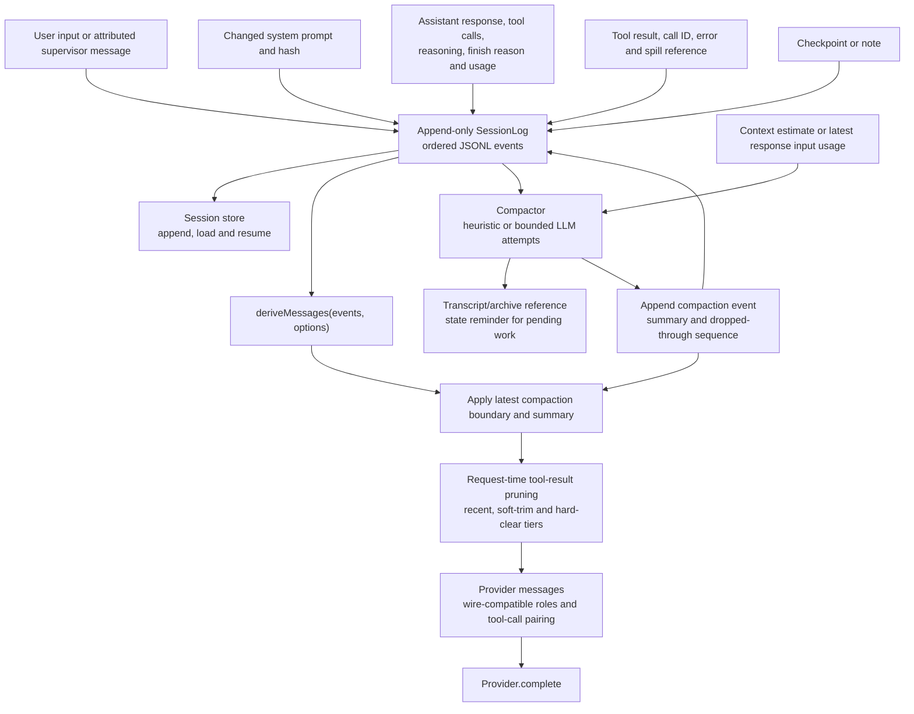

| Data / budget                  | Design requirement                                                                                  |
| ------------------------------ | --------------------------------------------------------------------------------------------------- |
| Event origin                   | Distinguish actual user text, supervisor injections and file references in storage                  |
| System prompt                  | Persist changed prompt text/hash; do not depend on reconstructing the exact past filesystem state   |
| Projection                     | Pruning and compaction affect the request view; never rewrite the source log                        |
| Tool pairing                   | Do not leave orphan tool results when choosing a compaction boundary                                |
| Threshold                      | Use current context / latest response input tokens, not a monotonically growing lifetime sum        |
| Estimate                       | Legacy UTF-8 bytes divided by 3.2 is a heuristic; compare with measured provider usage              |
| Planned context-window setting | Reserve output space before computing the trigger; fall back to absolute threshold when unknown     |
| Summary quality                | Preserve recent tail, pending work and transcript pointer; bounded retries for degenerate summaries |
| `/clear`                       | Planned new session ID; persisted history remains separate                                          |

OPEN persistence questions include partial final JSONL lines, concurrent
writers, sequence ordering, cancellation during append and resume after an
interrupted tool effect. Append-only storage alone does not implement those
behaviours or make a replay safe. WP3 needs explicit decisions and failure
fixtures before it can claim durable recovery.

## 8. PLANNED: config, trust and execution scope

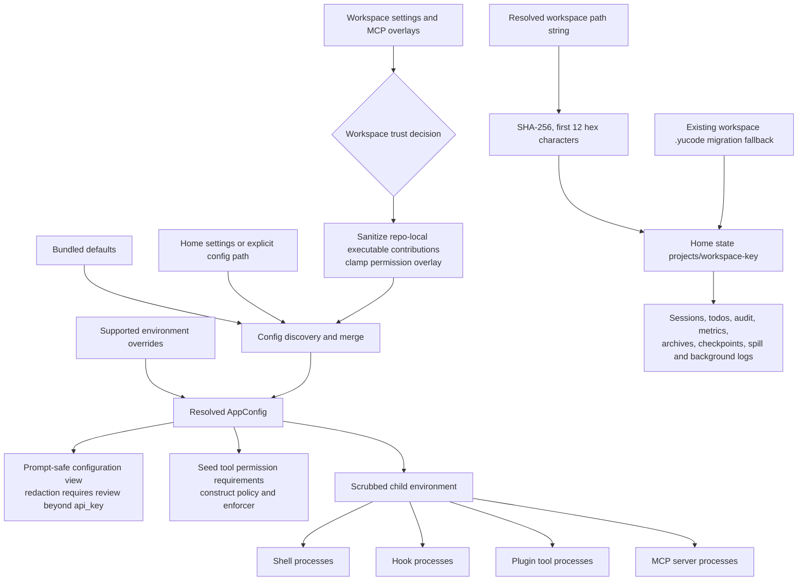

The discovery order, recursive merge, list concatenation, empty-overlay rules
and supported environment precedence are compatibility contracts. An explicit
config path changes which overlays load; consult summary §4 and the config
goldens rather than inferring precedence from this data-flow sketch.

The workspace hash uses the resolved path string. Changing separators or
case rules changes the state location. Trust in a repo-local config also
differs from authorization for a tool action; neither substitutes for an OS
sandbox. The TypeScript permission/path layers are not implemented yet.

## 9. PLANNED: tool packs and the Office dependency graph

Generic tools cover filesystem reads/writes, patching, search, shell, web,
todos, questions, skills, memory and MCP resources. The legacy catalogue also
contains names deliberately dropped from the port. Schema parity is a
per-tool contract; do not assume every legacy registration survives.

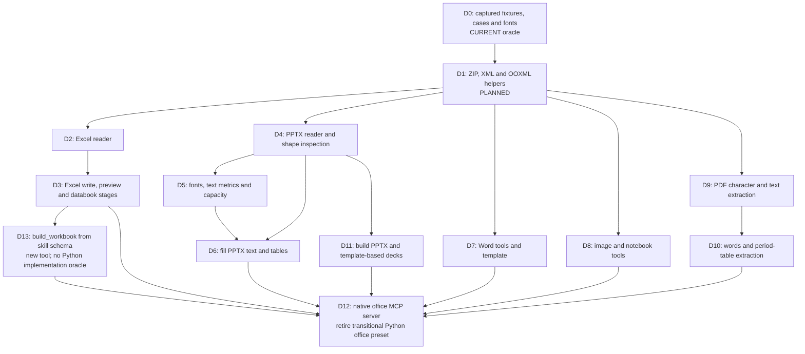

All D1–D13 nodes are PLANNED. Notebook is grouped with M3 implementation work,
although it is a generic legacy tool rather than one of the 22 Office tools.
The graph summarizes plan dependencies; it is not a new schedule estimate.

| Domain behaviour         | Oracle / deliberate decision                                                                                |
| ------------------------ | ----------------------------------------------------------------------------------------------------------- |
| Excel cells and formulas | Preserve cached values, numeric representations, shared strings and hidden-column semantics from cases      |
| Excel editing            | Planned fix preserves charts/pivots by editing sheet XML; hidden ranges hide the complete min..max interval |
| PPTX text metrics        | Use measured hinted advances; unhinted font-unit rounding fails on the system Arial cases                   |
| Portable vs system fonts | Portable subsets permit independent checks; passing them does not prove system-font parity                  |
| PPTX shapes and text     | Group traversal, CJK `a:ea`, bullets-only slides and progressive fill require named decisions/cases         |
| PDF coordinate tools     | Text content alone is insufficient for word coordinates and period-band assignment; D9 remains a major risk |
| Python numbers           | Python float formatting and binary-double half-even rounding must follow cases, not JavaScript defaults     |
| New workbook builder     | Structural XML assertions and a hand-checked example, plus owner Excel review; no invented Python golden    |
| Production skills        | Synthetic end-to-end checks for commentary decks and financial-statement extraction remain M3 gates         |

See plan §0.0 corrections 6–7 and 17–25, M3 work packages, and the
[Office manifest](tests/golden/office/manifest.json). A documented Python defect
is not automatically permission to change every related behaviour.

## 10. PLANNED: sub-agents and external integrations

The v1 design is a single ReAct loop. A bounded child-agent tool is planned
for M2; the legacy plan/research/work/validate coordinator is deferred to v2.
Adding more agents is not the remedy for a missing host-side invariant.

| Integration             | Boundary and completion behaviour                                                                                                     |
| ----------------------- | ------------------------------------------------------------------------------------------------------------------------------------- |
| Child agents            | In-process child runtime, explicit depth, role tools derived from permission classes, tracked completion and sub-agent audit identity |
| Background bash         | Track process and output; surface completion through ordered reminders; retention must protect live logs                              |
| MCP client              | Namespaced tools/resources, call timeout, process cleanup and bounded reconnect; compatibility tested against server fixtures         |
| Transitional Office MCP | Python on the Mac during M1/M2 only; native tools and server replace it in M3                                                         |
| Plugins                 | Trusted manifests contribute tools/hooks; executable tools use the normal tool pipeline and child-env scrubber                        |
| VS Code bridge          | JSONL compatibility, runtime per workspace, bounded cache and save-on-eviction behaviour                                              |
| HTTP/SSE server         | Loopback bind, per-run bearer token, Origin checks, authenticated requests and event transport                                        |
| Ink TUI                 | Consumer of runtime events; input/paste and confirmation state remain outside the core loop                                           |

Each child hop adds context transfer, latency and failure modes. Before
expanding orchestration, demonstrate a failure in the single loop and measure
whether a child improves it under the same task and budget. This is a review
criterion for future work, not evidence that the planned child tool already
passes that comparison.

## 11. Methodology: what the evidence can establish

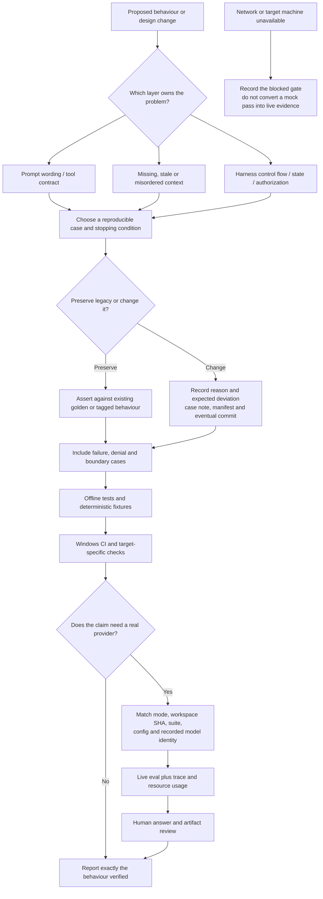

| Evidence                     | What it supports                                               | What it cannot establish alone                                     |
| ---------------------------- | -------------------------------------------------------------- | ------------------------------------------------------------------ |
| Source review `[V]`          | Branch order, reachable code, missing invalidation or bypasses | Successful execution on every platform                             |
| Reproduced measurement `[M]` | A concrete input/output under recorded conditions              | General correctness beyond those conditions                        |
| Oracle recapture             | Maintained recipes still reproduce their owned outputs         | Correctness of every projection, live baseline or omitted case     |
| Scanner negative tests       | Specific forbidden layouts/headers/links are rejected          | Complete package safety or target EDR approval                     |
| Fake-runtime eval wiring     | Config injection, state isolation and report flags             | Real model decisions, answer correctness or provider compatibility |
| Mechanical eval verdicts     | Call budget, at-least-one-read and artifact-mention criteria   | Whether the explanation or generated artifact is correct           |
| Target-box checks            | Windows quoting, input, fonts and EDR under that setup         | Behaviour on untested target configurations                        |

### OPEN issues to resolve before claiming a working agent

These are design-review findings or pending tests. They are not additional
features approved for implementation in this documentation pass.

| Priority | Issue and evidence                                                                                                           | Required decision or verification                                                                                          |
| -------- | ---------------------------------------------------------------------------------------------------------------------------- | -------------------------------------------------------------------------------------------------------------------------- |
| P0       | There is no TypeScript runtime yet; only the scaffold exists                                                                 | Keep roadmap status tied to files and executable gates; never report a planned module as shipped                           |
| P0       | LEGACY `allow` mode ignores deny rules; correction 28                                                                        | Explicitly preserve or change policy, with mode-by-rule tests and a named deviation if changed                             |
| P0       | LEGACY `check_bash` read-only relaxation has no production caller; correction 15                                             | Decide whether to wire it in or omit it; preserve live sed/path-traversal checks per correction 26                         |
| P0       | A schema, prompt or regex does not provide an OS process sandbox                                                             | Document the actual permission boundary and residual shell escape patterns; prove refusal paths in host code               |
| P1       | LEGACY read/write/read cache staleness reproduced with real runtime/tools and scripted provider (`runtime.py:837,1097–1108`) | Turn the measured sequence below into a port regression case; decide invalidation semantics and document any parity change |
| P1       | LEGACY enforcer deliberately defers in prompt mode (`permissions.py:286`); interactive policy handles the decision           | Preserve the deferral and test both prompter/no-prompter paths; do not turn a regression risk into a claimed legacy defect |
| P1       | Pre hooks see raw argument JSON before parsing                                                                               | Test malformed/truncated arguments and hook denial; explicitly decide any ordering change                                  |
| P1       | Planned append-only log leaves crash/concurrency/replay details unspecified                                                  | Define partial-line handling, ordering and interrupted-effect recovery before asserting durability                         |
| P1       | Output redaction does not describe every storage sink                                                                        | Test prompt config, custom auth headers, hooks, audit, spill and logs without committing real secrets                      |
| P1       | Retry/self-heal/stream/eval layers can compound work                                                                         | Measure total attempts, elapsed time and cancellation; ensure partial tool effects are not replayed blindly                |
| P1       | Recorded SSE fixtures were never captured                                                                                    | Supply synthetic boundary/error fixtures first; later add scrubbed real traces without replacing deterministic tests       |
| P1       | Old eval used coordinator and a different current workspace HEAD                                                             | Use the historical snapshot and single mode; pin suite/config; retain uncertainty about historical config/model revision   |
| P1       | Mechanical scores omit answer correctness                                                                                    | Add explicit human conclusions and artifact review; retain failed and partial runs                                         |
| P1       | Fixture projections and normalizers previously hid defects                                                                   | Test that a meaningful output mutation fails comparison, and that normalization removes only nondeterminism                |
| P1       | Portable fonts do not exercise every system-font divergence                                                                  | Retain both kinds of cases; confirm the actual Windows font pair                                                           |
| P1       | Windows CI does not reproduce the locked-down box                                                                            | Keep EDR/WASM, paste, shell quoting and target fonts as separate owner-run gates                                           |
| P2       | New workbook builder has no original Python implementation available                                                         | Derive assertions from the skill schema/format docs and hand-review a real workbook                                        |
| P2       | Work-package sizes were underestimates in M0                                                                                 | Re-estimate from fixtures and acceptance cases before coding; avoid inheriting prose LOC estimates as commitments          |

The cache issue was reproduced offline using the actual tagged runtime and
filesystem tools with a scripted provider. The run used single mode, strong
tier, the default dedup threshold of three, and an isolated temporary workspace
and state directory. No live provider was instantiated.

| Step       | Scripted call / observed result                                  |
| ---------- | ---------------------------------------------------------------- |
| Setup      | `sample.txt` contains `before` followed by a newline             |
| 1          | `read_file({"path":"sample.txt"})` returns line `1\|before`      |
| 2          | `write_file({"path":"sample.txt","content":"after\n"})` succeeds |
| 3          | The identical `read_file` call still returns line `1\|before`    |
| Disk check | The file contains `after` followed by a newline                  |

Post-tool reminders were excluded from the result-content comparison. This
measurement is a design finding, not a new committed golden or a chosen cache
invalidation policy. The [review journal](docs/journal/2026-10-26_review.md)
records it alongside the documentation handoff.

A stronger model may change which tasks the agent can solve; it does not
remove the need to define authorization, state recovery and test oracles.

## 12. Resume map and work-package gates

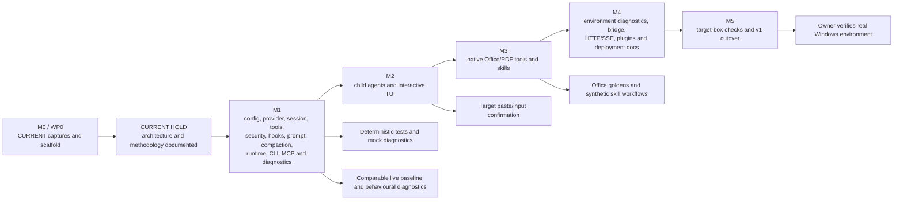

| Milestone | Work packages / exit evidence                                                                                                                                               |
| --------- | --------------------------------------------------------------------------------------------------------------------------------------------------------------------------- |
| M0 / WP0  | Captures, legacy freeze, scaffold, dependency policy and executable entry point; outstanding target-box checks remain outstanding                                           |
| M1        | WP1 config, WP2 provider, WP3 session, WP4 tools, WP5 security, WP6 hooks, WP7 prompt, WP8 compaction, WP9 runtime/observability, WP10 CLI, WP11 MCP, WP12 diagnostics/eval |
| M2        | WP13 child agents/background tables; WP14 input buffer, transcript, commands and confirmations; real paste testing                                                          |
| M3        | D1–D13 native domain tools/server, per-case goldens, deliberate deviations, synthetic skill end-to-end runs                                                                 |
| M4        | WP20 environment diagnostics, WP21 bridge, WP22 HTTP/SSE, WP23 plugins, WP24 docs and deployable bundle                                                                     |
| M5        | Real target deployment, diagnostics, skills, input, provider and EDR checks; release only after these gates                                                                 |

At resumption, read plan §0.0, architecture, the Python summary and the affected
goldens in that order. Verify the worktree before touching it: review changes
may still be uncommitted. Start with WP1's config/state-layout oracle rather
than inventing another agent layer. Do not upgrade dependencies as part of
resuming; any upgrade requires a fresh dependency-tree check.

The last local review passed lint, typecheck, 14 Node tests, build, the binary
scan and all three golden recaptures. That is a dated local result, recorded in
the [2026-10-26 journal](docs/journal/2026-10-26_review.md), not a standing CI
badge or a claim that M1 has passed. The single-mode live eval has not run.

## Build and check the current scaffold

Use Node 24 as required by the package and a compatible npm installation.
Install without lifecycle scripts; do not install or link this package globally.

```sh
npm ci --ignore-scripts
npm run check:binaries
npm run typecheck
npm run lint
npm test
npm run build
node dist/cli/main.js version
```

To recapture the Python goldens, unpack the legacy tree if absent:

```sh
mkdir -p _legacy_python
git archive python-final | tar -x -C _legacy_python
python3 tools/golden/check_all.py
```

Use a Python environment with the required legacy capture libraries installed.
A missing library is an environment failure, not evidence that the golden
changed. `check_all.py` does not contact the provider or reproduce the historical
live eval. The earlier analysis documents remain in [docs/legacy/](docs/legacy/).
